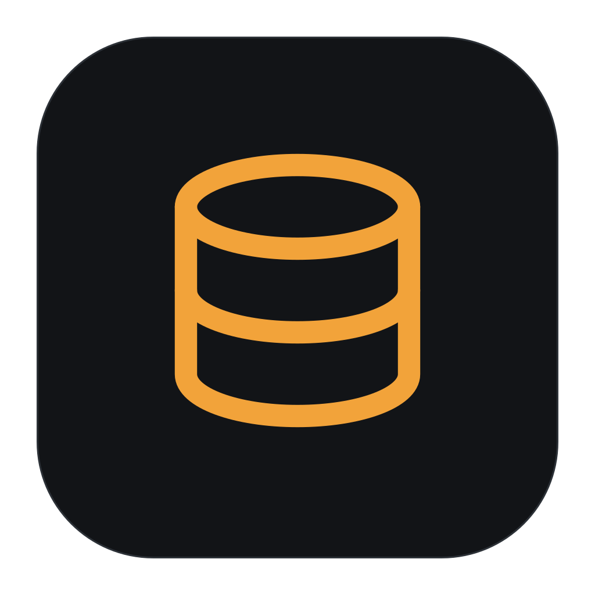
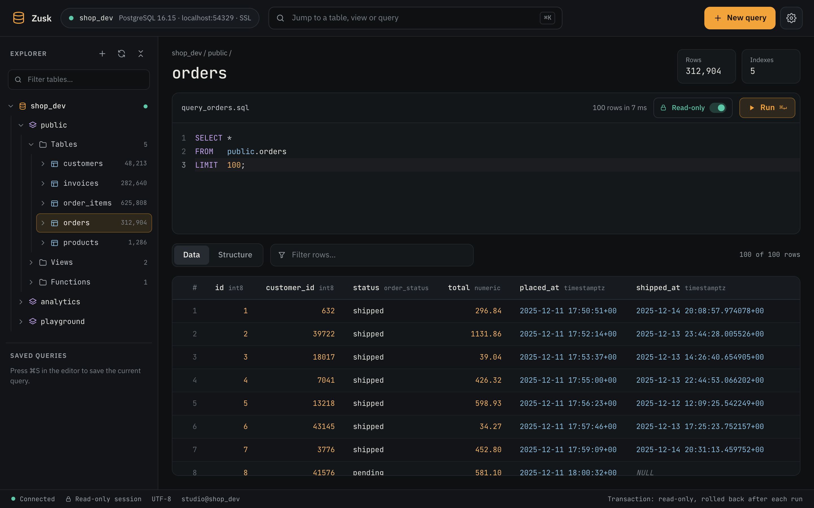
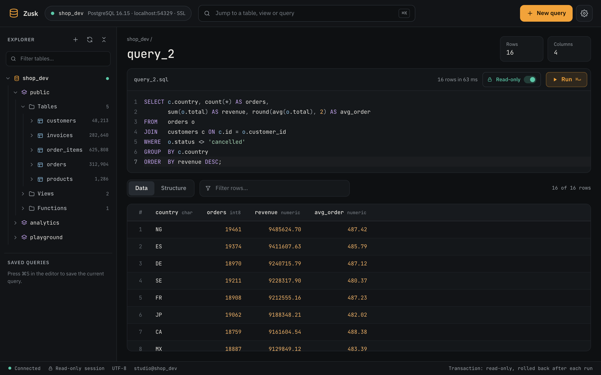
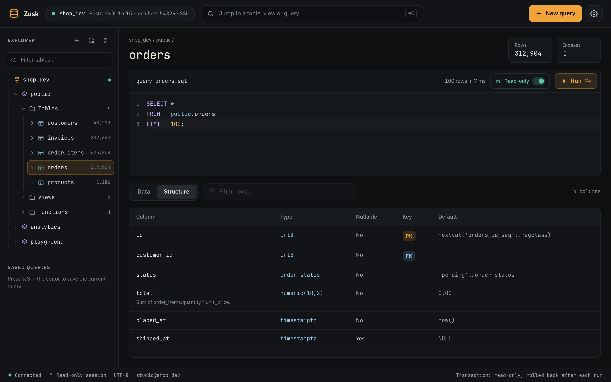
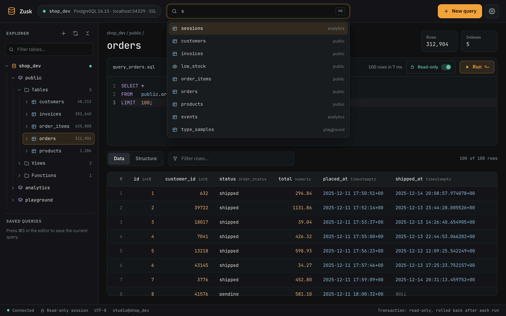
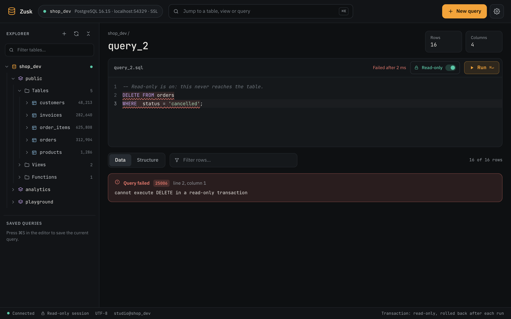
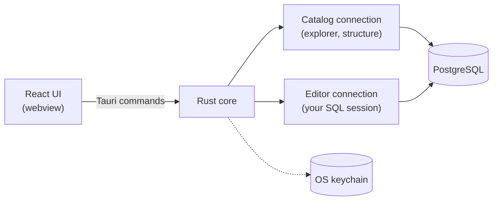

<div align="center">



# Zusk

**A calm, fast desktop client for PostgreSQL. Read-only until you say otherwise.**


[](https://github.com/shubhranka/zusk/actions/workflows/ci.yml)
[](LICENSE)

[Features](#features) · [Download](#download) · [Run from source](#run-from-source) · [Shortcuts](#keyboard-shortcuts) · [How it works](#how-it-works) · [Contributing](#contributing)

<br>



</div>

<br>

Zusk is a native desktop app for exploring and querying PostgreSQL. You can browse schemas, preview a table with one click, and write SQL in an editor that knows your tables. Results land in a grid that shows values exactly as `psql` would.

All database work happens in a Rust core. The interface never talks to Postgres directly, and every session starts **read-only**, enforced by the server itself.

<table>
<tr>
<td width="33%" valign="top">

**One-click previews**<br>
<sub>Click any table or view to see its first 100 rows, an estimated row count and its indexes.</sub>

</td>
<td width="33%" valign="top">

**Safe by default**<br>
<sub>Every run happens in a read-only transaction that is rolled back. Writes are an explicit switch.</sub>

</td>
<td width="33%" valign="top">

**psql-faithful**<br>
<sub>Multi-statement scripts, dollar quoting and session state behave the way they do in <code>psql</code>.</sub>

</td>
</tr>
<tr>
<td valign="top">

**Fast at any size**<br>
<sub>A virtualized grid scrolls through up to 100,000 rows per run.</sub>

</td>
<td valign="top">

**Secrets stay secret**<br>
<sub>Passwords live in the OS keychain. The saved connection list never contains them.</sub>

</td>
<td valign="top">

**Keyboard first**<br>
<sub>Jump anywhere with <kbd>⌘</kbd><kbd>K</kbd>, run with <kbd>⌘</kbd><kbd>↵</kbd>, copy with <kbd>⌘</kbd><kbd>C</kbd>.</sub>

</td>
</tr>
</table>

## A closer look

<table>
<tr>
<td width="50%"></td>
<td width="50%"></td>
</tr>
<tr>
<td align="center"><sub><b>Write and run SQL.</b> Autocompletion, typed result columns and timings.</sub></td>
<td align="center"><sub><b>Read the structure.</b> Types, keys, defaults and column comments.</sub></td>
</tr>
<tr>
<td width="50%"></td>
<td width="50%"></td>
</tr>
<tr>
<td align="center"><sub><b>Jump anywhere.</b> Every table, view and saved query, across schemas.</sub></td>
<td align="center"><sub><b>Nothing changes by accident.</b> Postgres refuses writes in read-only mode.</sub></td>
</tr>
</table>

## Features

### Explore

- **Explorer tree.** Connections, schemas, tables, views, materialized views and functions, with row estimates beside each table.
- **Column peek.** Expand a table to list its columns, with primary and foreign keys marked.
- **Instant previews.** Click a table or view to run `SELECT * … LIMIT 100`. The header shows estimated rows and index count.
- **Function source.** Click a function to open its definition in the editor.
- **Filter and jump.** Filter the tree as you type, or press <kbd>⌘</kbd><kbd>K</kbd> to jump to any table, view or saved query.

### Write and run

- **A real SQL editor.** CodeMirror 6 with the PostgreSQL dialect, autocompletion from your schema, bracket matching and search.
- **psql-style scripts.** Scripts are split into statements and run one by one. The splitter handles quoted strings and identifiers, dollar quoting, nested comments and `BEGIN ATOMIC` bodies.
- **Run what you mean.** <kbd>⌘</kbd><kbd>↵</kbd> runs the selection if there is one, otherwise the whole editor. **Stop** cancels the query on the server.
- **Useful errors.** Failures show the SQLSTATE code, Postgres' detail and hint, and the exact line and column, underlined in the editor.
- **Fix with AI.** When a statement fails, **Fix with AI** asks your model to correct it and swaps in the fix, which you can undo with <kbd>⌘</kbd><kbd>Z</kbd>. Set it up under **Settings → AI** with Anthropic, Gemini, or any OpenAI-compatible server (OpenAI, OpenRouter, Ollama, LM Studio). It sends the failing statement, the error, and the names and types of the tables involved, never row data. The API key is stored in the OS keychain.
- **Saved queries.** Press <kbd>⌘</kbd><kbd>S</kbd> to keep a query in the sidebar and in the jump box.

### Read results

- **Faithful values.** Every value comes back as Postgres' own text, so the grid shows what `psql` would. Numbers, booleans, dates and `NULL` are styled by type, and each header shows its column type.
- **Built for big results.** The grid renders only what's on screen and holds up to 100,000 rows per run. The toolbar tells you when a result was cut off.
- **Quick filtering.** Filter rows as you type, or right-click a cell and choose **Filter rows by this value**.
- **Copy anything.** Copy a value, a row as tab-separated text, a row as JSON, or a column name. Use the arrow keys to move between cells.
- **Structure tab.** Columns, types, nullability, PK, FK and UNIQUE markers, defaults, identity and generated columns, and comments.

### Stay safe

- **Read-only by default.** Every launch starts read-only, and the server enforces it (see [below](#read-only-by-default)).
- **Clear transaction state.** With writes enabled, the status bar shows whether you're in auto-commit, an open transaction or an aborted one.
- **Passwords in the keychain.** Passwords are stored in macOS Keychain, Windows Credential Manager or the Secret Service on Linux.
- **TLS your way.** Choose `disable`, `prefer`, `require`, `verify-ca` or `verify-full` per connection, and **Test** a connection before you save it.

### Make it yours

- Four accent colours, comfortable or compact rows, optional zebra striping, and a resizable editor.

## Read-only by default

Zusk doesn't just hide the write buttons. While read-only mode is on:

1. Each run is wrapped in `BEGIN READ ONLY … ROLLBACK`.
2. A snapshot is taken straight away, so the transaction can't be switched to read-write.
3. Statements that would end the transaction early (`COMMIT`, `BEGIN`, `ROLLBACK`, …) are refused before anything is sent.

Any `INSERT`, `UPDATE`, `DELETE` or DDL is rejected by Postgres itself, with SQLSTATE `25006`.

To make changes, flip the **Read-only** switch next to **Run** or in the status bar. Statements then auto-commit, and an open `BEGIN` stays open across runs, just like `psql`.

> [!NOTE]
> While read-only mode is on, `SET` commands don't carry over between runs, because each run is rolled back.

## Keyboard shortcuts

| Action | macOS | Windows / Linux |
| --- | --- | --- |
| Jump to a table, view or saved query | <kbd>⌘</kbd> <kbd>K</kbd> | <kbd>Ctrl</kbd> <kbd>K</kbd> |
| Run the selection, or everything | <kbd>⌘</kbd> <kbd>↵</kbd> | <kbd>Ctrl</kbd> <kbd>Enter</kbd> |
| Save the current query | <kbd>⌘</kbd> <kbd>S</kbd> | <kbd>Ctrl</kbd> <kbd>S</kbd> |
| Copy the selected cell | <kbd>⌘</kbd> <kbd>C</kbd> | <kbd>Ctrl</kbd> <kbd>C</kbd> |
| Copy the selected row | <kbd>⇧</kbd> <kbd>⌘</kbd> <kbd>C</kbd> | <kbd>Shift</kbd> <kbd>Ctrl</kbd> <kbd>C</kbd> |
| Move around the grid | <kbd>←</kbd> <kbd>↑</kbd> <kbd>→</kbd> <kbd>↓</kbd> | <kbd>←</kbd> <kbd>↑</kbd> <kbd>→</kbd> <kbd>↓</kbd> |
| Clear the row filter or selection | <kbd>Esc</kbd> | <kbd>Esc</kbd> |

## Download

Get the latest installer for macOS, Windows or Linux from the [**Releases page**](https://github.com/shubhranka/zusk/releases/latest).

> [!IMPORTANT]
> Zusk isn't code-signed yet, so your OS will warn you the first time you open it.
>
> - **macOS:** if macOS says Zusk is damaged or can't be checked, move it to Applications, run `xattr -dr com.apple.quarantine /Applications/Zusk.app`, and open it again.
> - **Windows:** in the SmartScreen dialog, click **More info**, then **Run anyway**.
> - **Linux:** install the `.deb` or `.rpm`, or make the `.AppImage` executable with `chmod +x` and run it.

## Run from source

You'll need [Node.js](https://nodejs.org) 22 or newer, a [Rust toolchain](https://rustup.rs), the [Tauri prerequisites](https://tauri.app/start/prerequisites/) for your OS, and Docker for the demo database.

```sh
npm install
npm run db:up          # Postgres 16 with seed data on localhost:54329
npm run tauri dev      # launch Zusk
```

Click **+** in the explorer and add the demo database:

| Field | Value |
| --- | --- |
| Host | `localhost` |
| Port | `54329` (set `ZUSK_PG_PORT` to change it) |
| User / password | `studio` / `studio` |
| Database | `shop_dev`, or `warehouse` for a second connection |
| SSL | `prefer` or `require`. The demo certificate is self-signed, so the `verify-*` modes fail on purpose. |

`shop_dev` holds a small shop (customers, orders, invoices), an analytics schema and a playground table with one row per interesting Postgres type. `warehouse` is a separate star-schema database, so you can see two connections side by side. Run `npm run db:reset` to wipe it and start fresh.

To build a release bundle for your platform:

```sh
npm run tauri build
```

## How it works



- **The webview never touches the database.** It calls a small set of typed commands, and the Rust core does the rest, using `tokio-postgres` with native TLS.
- **Two connections per server.** The catalog connection serves the explorer and can run alongside your queries. The editor connection is your session, so `SET`, `BEGIN` and temp tables persist between runs. Both reconnect on their own if dropped.
- **Types without re-running.** Queries use the simple protocol, like `psql`. Column types are filled in afterwards by preparing the statement, without running it again.

<details>
<summary><b>Project layout</b></summary>

```
src/                       React UI
  store/app.ts             app state (zustand): connections, tree, editor, runs
  lib/api.ts               typed wrappers for the Rust commands
  components/              header, explorer, workspace (editor + results), dialogs
src-tauri/src/
  commands.rs              every command the UI can call
  db/session.rs            connections: TLS modes, editor session, reconnect, cancel
  db/query.rs              running SQL, read-only enforcement, row cap, types
  db/splitter.rs           psql-style statement splitter
  db/catalog.rs            pg_catalog queries for the explorer and Structure tab
  ai.rs                    AI providers (Anthropic, Gemini, OpenAI-compatible) and the Fix with AI prompt
  profiles.rs              saved connections (JSON in the app config dir, no passwords)
  secrets.rs               passwords and API keys in the OS keychain
docker/                    seed SQL, and the script that makes a localhost TLS certificate
zusk-design.dc.html        the visual reference the UI is built from
```

</details>

## Development

### Tests

```sh
npm test                                                   # UI logic (Vitest)
cargo test --manifest-path src-tauri/Cargo.toml            # splitter, type names
cargo test --manifest-path src-tauri/Cargo.toml -- --include-ignored
#   also runs the integration tests against the Docker database,
#   and a real keychain round trip (it creates and deletes a test entry)
```

### Working on the UI in a browser

```sh
npm run dev:bridge     # serves the same Rust commands on 127.0.0.1:1421
npm run dev            # then open http://localhost:1420
```

The bridge is for development only. It listens on loopback, keeps passwords in memory rather than the keychain, and stores its connection list in a temp directory. Production builds don't include the browser code path.

> [!TIP]
> Each debug build has a new code signature, so macOS may ask for keychain access again after a rebuild. Choose **Always Allow**. Signed release builds don't have this problem.

## Contributing

Bug reports, ideas and pull requests are welcome. [CONTRIBUTING.md](CONTRIBUTING.md) explains how to set up, run the checks and send a change. Please report security problems privately, as described in [SECURITY.md](SECURITY.md).

Release notes are in [CHANGELOG.md](CHANGELOG.md).

## License

Zusk is released under the [MIT License](LICENSE).

<br>

<div align="center">
<sub>Built with Tauri, Rust, React and CodeMirror.</sub>
</div>
